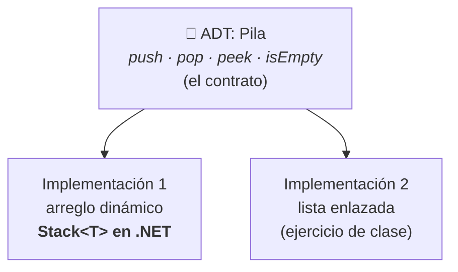
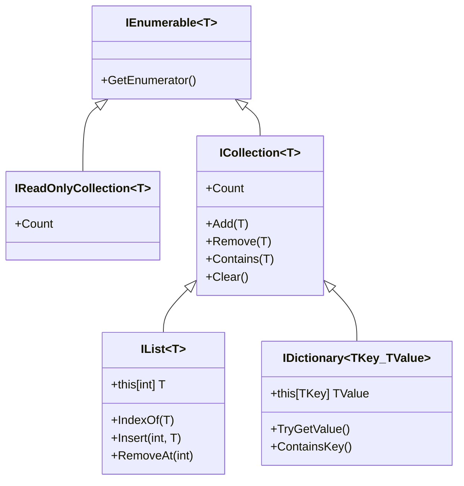

# 🧭 1. Introducción a las colecciones

[🏠 Inicio](Home) · Siguiente: [🧱 Arreglos →](02-Arreglos)

> **Objetivo:** entender qué es una colección, por qué existen distintas y con qué criterios se elige una.

---

## 1.1 ¿Qué es una colección?

Una **colección** es un objeto cuya función es agrupar otros objetos y ofrecer operaciones para almacenarlos, recuperarlos y recorrerlos. Sin ellas tendríamos que declarar una variable por dato (`nota1`, `nota2`, `nota3`…), algo inviable cuando la cantidad no se conoce de antemano.

Cada colección responde a una pregunta distinta:

| Colección | Pregunta que responde |
|-----------|-----------------------|
| `T[]` | ¿Tengo una cantidad **fija** de elementos y necesito acceso inmediato por posición? |
| `List<T>` | ¿Necesito una secuencia que **crece y decrece**? |
| `Stack<T>` | ¿Debo procesar primero lo **último** que llegó? |
| `Queue<T>` | ¿Debo procesar primero lo **primero** que llegó? |
| `Dictionary<K,V>` | ¿Necesito encontrar un valor a partir de una **clave**, de forma casi instantánea? |

## 1.2 Tipo abstracto de datos vs. estructura de datos

Esta distinción es la base teórica de todo el curso (Liskov & Zilles, 1974):

- **Tipo abstracto de datos (ADT):** especifica *qué* operaciones ofrece y qué comportamiento cumplen, sin decir cómo se implementan. Ejemplo: una **pila** es "algo" con `push`, `pop` y `peek` tal que `pop` devuelve el último elemento insertado.
- **Estructura de datos:** es la *implementación concreta* de ese contrato, con una organización de memoria y algoritmos específicos. Ejemplo: una pila puede implementarse sobre un arreglo o sobre una lista enlazada.



💡 **Por qué importa:** si programas contra el contrato, puedes cambiar la implementación sin romper el resto del programa. En C# ese contrato se expresa con **interfaces**.

## 1.3 El ecosistema de colecciones en .NET

.NET organiza sus colecciones en *namespaces* (Microsoft, s. f.-a):

| Namespace | Contenido | ¿Lo usaremos? |
|-----------|-----------|:-------------:|
| `System` | La clase `Array` (base de todos los arreglos `T[]`) | ✅ |
| `System.Collections.Generic` | `List<T>`, `Stack<T>`, `Queue<T>`, `Dictionary<K,V>`, `HashSet<T>`, `PriorityQueue<,>`… | ✅ |
| `System.Collections` | Colecciones **no genéricas** (`ArrayList`, `Hashtable`) — heredadas | ⚠️ Solo para contrastar |
| `System.Collections.Concurrent` | Versiones seguras para múltiples hilos (`ConcurrentQueue<T>`…) | Mención |
| `System.Collections.Immutable` | Colecciones inmutables | Mención |

### Genéricos vs. no genéricos

Antes de C# 2.0 (2005) solo existían colecciones que guardaban `object`. Eso implicaba dos problemas:

1. **Sin seguridad de tipos:** un `ArrayList` acepta números y cadenas mezclados; el error aparece en ejecución, no al compilar.
2. **Boxing/unboxing:** cada `int` guardado se *empaqueta* como objeto en el *heap* y hay que convertirlo de vuelta al leerlo, con costo de memoria y tiempo.

Los **genéricos** (`List<int>`) resuelven ambos: el compilador verifica los tipos y los valores se almacenan sin empaquetar (Albahari, 2023, cap. 7; Troelsen & Japikse, 2022, cap. 10). Microsoft desaconseja usar las colecciones no genéricas en código nuevo.

```csharp
// ❌ No genérico: acepta cualquier cosa y hace boxing
var viejo = new System.Collections.ArrayList();
viejo.Add(10);
viejo.Add("diez");              // compila... y es un error lógico
int x = (int)viejo[1];          // 💥 InvalidCastException en ejecución

// ✅ Genérico: el compilador te protege
var moderno = new List<int>();
moderno.Add(10);
// moderno.Add("diez");         // error de compilación
```

## 1.4 Jerarquía de interfaces

Las colecciones genéricas se organizan alrededor de unas pocas interfaces. Conocerlas permite escribir métodos que acepten "cualquier secuencia" en lugar de un tipo concreto.



| Tipo concreto | Implementa |
|---------------|------------|
| `T[]` | `IList<T>` (y por tanto `ICollection<T>`, `IEnumerable<T>`) |
| `List<T>` | `IList<T>`, `IReadOnlyList<T>` |
| `Dictionary<K,V>` | `IDictionary<K,V>`, `IReadOnlyDictionary<K,V>` |
| `Stack<T>` | `IEnumerable<T>`, `IReadOnlyCollection<T>` — **no** `IList<T>` |
| `Queue<T>` | `IEnumerable<T>`, `IReadOnlyCollection<T>` — **no** `IList<T>` |

💡 **Regla práctica de diseño:** los *parámetros* de tus métodos deben usar la interfaz más pequeña que necesites (`IEnumerable<T>` si solo recorres); el tipo concreto se decide al *crear* la colección.

```csharp
// Funciona con arreglos, listas, pilas, colas, HashSet...
static double Promedio(IEnumerable<double> notas) => notas.Average();
```

## 1.5 ¿Cómo funciona `foreach`? — `IEnumerable<T>`

`foreach` no es magia: el compilador lo traduce a llamadas sobre un **enumerador** (patrón *Iterador*).

```csharp
foreach (var x in coleccion) { Console.WriteLine(x); }

// equivale, en esencia, a:
using var e = coleccion.GetEnumerator();
while (e.MoveNext())
{
    var x = e.Current;
    Console.WriteLine(x);
}
```

🔬 **Detalle importante:** las colecciones como `List<T>`, `Stack<T>`, `Queue<T>` y `Dictionary<K,V>` mantienen un contador interno de versión que aumenta con cada modificación estructural. El enumerador lo compara y, si cambió durante el recorrido, lanza `InvalidOperationException`. Es el error clásico de "modificar una colección dentro de `foreach`" (ver [Listas §3.7](03-Listas#37-error-clásico-modificar-dentro-de-foreach)).

## 1.6 Análisis de complejidad: el lenguaje para comparar

Para decidir entre colecciones usamos la **notación asintótica** (Cormen et al., 2022, cap. 3), que describe cómo crece el costo de una operación cuando el número de elementos *n* aumenta.

| Notación | Nombre | Si *n* se duplica, el costo… | Ejemplo |
|:--------:|--------|------------------------------|---------|
| O(1) | Constante | no cambia | `array[i]` |
| O(log n) | Logarítmica | sube una unidad fija | búsqueda binaria |
| O(n) | Lineal | se duplica | `list.Contains(x)` |
| O(n log n) | Lineal-logarítmica | un poco más que se duplica | `Array.Sort` |
| O(n²) | Cuadrática | se cuadruplica | quitar del frente de una lista *n* veces |

### Costo amortizado y caso promedio

Dos conceptos que verás en las tablas:

- **O(1) amortizado** — una operación suele costar O(1), pero ocasionalmente cuesta más (p. ej., redimensionar). Si se promedia sobre una *secuencia completa* de operaciones, el costo por operación sigue siendo constante (Cormen et al., 2022, cap. sobre análisis amortizado).
- **O(1) en promedio** — el costo depende de supuestos probabilísticos (p. ej., que la función hash distribuya bien las claves). En el peor caso puede degradarse a O(n) (Cormen et al., 2022, cap. 11).

⚠️ Big-O describe **crecimiento**, no tiempo absoluto. Para colecciones pequeñas una estructura "peor" asintóticamente puede ser más rápida en la práctica por localidad de memoria. Ante la duda: **medir** (ver [Comparativa](07-Comparativa-y-Complejidad)).

## 1.7 ¿Cómo elegir? Árbol de decisión

```mermaid
flowchart TD
    S([¿Qué necesito?]) --> Q1{¿Busco por<br/>una clave?}
    Q1 -- Sí --> D[🗝️ Dictionary / HashSet]
    Q1 -- No --> Q2{¿Orden de salida<br/>especial?}
    Q2 -- "Último en entrar,<br/>primero en salir" --> P[🥞 Stack&lt;T&gt;]
    Q2 -- "Primero en entrar,<br/>primero en salir" --> C[🚶 Queue&lt;T&gt;]
    Q2 -- "Por prioridad" --> PQ[⭐ PriorityQueue]
    Q2 -- "No, acceso por posición" --> Q3{¿Cambia la<br/>cantidad de elementos?}
    Q3 -- Sí --> L[📈 List&lt;T&gt;]
    Q3 -- "No, tamaño fijo" --> A[🧱 T&#91;&#93;]
```



## 🧠 Preguntas para pensar

1. ¿Por qué `Stack<T>` y `Queue<T>` **no** ofrecen un indexador `pila[i]`? ¿Qué garantía del ADT se rompería?
2. Si una pila es un ADT, ¿podrías implementarla con una `List<T>`? ¿Qué operación de la lista usarías para `pop`?
3. ¿Qué ventaja tiene que un método reciba `IEnumerable<T>` en lugar de `List<T>`?

---
[🏠 Inicio](Home) · Siguiente: [🧱 Arreglos →](02-Arreglos) · [📚 Referencias](Referencias)
