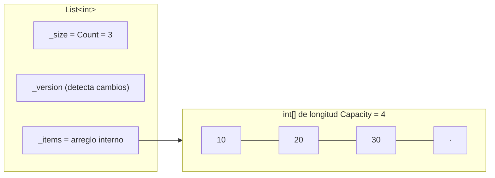

# 📈 3. Listas (`List<T>`)

← [Arreglos](02-Arreglos) · [🏠 Inicio](Home) · Siguiente: [🥞 Pilas →](04-Pilas)

> **Objetivo:** comprender la lista como **arreglo dinámico**, su estrategia de crecimiento y por qué la mayoría de las operaciones cuestan lo que cuestan.
>
> 💻 **Código de este tema:** [`DemoListas.cs`](https://github.com/chaotzu/colecciones-csharp/blob/main/Ejemplos/02_Listas/DemoListas.cs) → `dotnet run -- 2`

---

## 3.1 Definición

`List<T>` representa una secuencia de elementos de tipo `T` **accesibles por índice**, que puede **crecer y encogerse** durante la ejecución (Microsoft, s. f.-c). En la literatura se le llama **arreglo dinámico** o *tabla dinámica* (Cormen et al., 2022, cap. 16).

> 💡 No confundir con la "lista enlazada" de los textos de algoritmos. `List<T>` **no** es una lista enlazada: por dentro es un **arreglo**. La lista enlazada en .NET es `LinkedList<T>`.

## 3.2 🔬 Cómo funciona por dentro

Una `List<T>` mantiene tres cosas:



- **`Count`**: cuántos elementos *reales* hay.
- **`Capacity`**: cuántos caben en el arreglo interno *sin reservar uno nuevo*. Siempre `Capacity ≥ Count`.
- Cuando `Add` encuentra el arreglo lleno, **reserva uno más grande (el doble)**, copia los elementos y descarta el anterior.

El código fuente de .NET es público ([dotnet/runtime](https://github.com/dotnet/runtime), archivo `List.cs`) y puedes comprobarlo. Esto lo imprime el ejemplo del repositorio:

```
Count =  1  ->  Capacity = 4
Count =  5  ->  Capacity = 8
Count =  9  ->  Capacity = 16
Count = 17  ->  Capacity = 32
Count = 33  ->  Capacity = 64
```

### ¿Por qué `Add` es O(1) **amortizado**?

Una redimensión cuesta O(n), pero ocurre pocas veces. Si la capacidad se duplica, al agregar *n* elementos las copias totales son:

```
1 + 2 + 4 + 8 + … + n/2  <  n
```

(una serie geométrica). Es decir, el costo **total** de *n* inserciones es menor que *2n* operaciones elementales; repartido entre las *n* inserciones, **cada una cuesta O(1) en promedio** (Cormen et al., 2022, cap. 16, "tablas dinámicas").

⚠️ Si en cambio la capacidad creciera de a **+10** elementos, el costo total sería O(n²). La **duplicación** (crecimiento geométrico) es lo que hace funcionar la idea.

## 3.3 Creación

```csharp
var a = new List<int>();                       // vacía, Capacity = 0
var b = new List<int>(capacity: 1_000);        // reserva espacio por adelantado
var c = new List<string> { "Ana", "Luis" };    // inicializador de colección
List<string> d = ["Ana", "Luis"];              // expresión de colección (C# 12)
var e = new List<int>(otroArreglo);            // copia desde cualquier IEnumerable<int>
```

💡 Si conoces (o puedes estimar) el tamaño final, **pasa la capacidad inicial**: evitas redimensiones intermedias.

## 3.4 Operaciones principales

| Operación | Método / sintaxis | Costo |
|-----------|-------------------|:-----:|
| Leer / escribir por posición | `lista[i]` | O(1) |
| Agregar al final | `Add(x)` | O(1) amortizado |
| Agregar varios | `AddRange(coleccion)` | O(k) |
| Insertar en posición | `Insert(i, x)` | O(n) |
| Eliminar por posición | `RemoveAt(i)` | O(n) |
| Eliminar por valor | `Remove(x)` | O(n) |
| Eliminar según condición | `RemoveAll(predicado)` | O(n) |
| ¿Contiene? / posición | `Contains(x)` / `IndexOf(x)` | O(n) |
| Ordenar | `Sort()` | O(n log n) |
| Vaciar | `Clear()` | O(n)* |
| Cantidad | `Count` | O(1) |

\* O(1) si `T` no contiene referencias; en otro caso se limpian para permitir que el recolector libere memoria.

### Por qué insertar y eliminar en medio cuesta O(n)

Hay que **desplazar** todos los elementos posteriores una posición:

```
Insert(1, 99):   [10, 20, 30, 40]
                       ↓  ↓  ↓       desplaza 3 elementos
                 [10, 99, 20, 30, 40]
```

Insertar o quitar al **principio** es el peor caso (desplaza los *n* elementos). Si lo haces en un ciclo, el programa pasa a O(n²): el ejemplo [`DemoRendimiento.cs`](https://github.com/chaotzu/colecciones-csharp/blob/main/Ejemplos/06_Comparativa/DemoRendimiento.cs) mide esa diferencia frente a `Queue<T>`.

## 3.5 Búsqueda y transformación

```csharp
List<Estudiante> alumnos = ...;

Estudiante?       primero  = alumnos.Find(e => e.Promedio >= 9.0);   // primer coincidente o null
List<Estudiante>  aprobados = alumnos.FindAll(e => e.Promedio >= 7); // todos los coincidentes
bool              hayReprobado = alumnos.Exists(e => e.Promedio < 6);
List<string>      nombres = alumnos.ConvertAll(e => e.Nombre.ToUpper());
```

Los métodos reciben **delegados** (`Predicate<T>`, `Converter<T,U>`) expresados como lambdas `e => condición`. Con LINQ (`Where`, `Select`, `OrderBy`) se logra lo mismo de forma más general sobre cualquier `IEnumerable<T>`.

## 3.6 Ordenamiento: `Sort` vs. `OrderBy`

| | `lista.Sort(...)` | `lista.OrderBy(...)` (LINQ) |
|--|-------------------|-----------------------------|
| ¿Modifica la lista? | **Sí**, en sitio | No: produce una secuencia nueva |
| ¿Estable? | **No** (documentado como inestable) | **Sí** |
| Memoria extra | Mínima | Sí |
| Criterios múltiples | Con un `Comparison<T>` más elaborado | `.ThenBy(...)` |

*Estable* significa que los elementos con clave igual conservan su orden relativo previo (Cormen et al., 2022, cap. 8). Esto importa al ordenar por varios criterios sucesivos.

```csharp
alumnos.Sort((a, b) => b.Promedio.CompareTo(a.Promedio));          // en sitio, descendente
var orden = alumnos.OrderBy(e => e.Grupo).ThenBy(e => e.Nombre);   // estable, multicriterio
```

## 3.7 Error clásico: modificar dentro de `foreach`

```csharp
var lista = new List<int> { 1, 2, 3, 4 };
foreach (int x in lista)
    if (x == 2) lista.Remove(x);   // 💥 InvalidOperationException
```

Salida real:

```
InvalidOperationException: Collection was modified; enumeration operation may not execute.
```

El enumerador compara la `_version` de la lista con la que vio al empezar; si cambió, aborta (ver [§1.5](01-Introduccion-a-las-Colecciones#15-cómo-funciona-foreach--ienumerablet)). Dos formas correctas:

```csharp
// 1) RemoveAll: una sola pasada, la más clara y eficiente
int eliminados = lista.RemoveAll(x => x % 2 == 0);

// 2) Recorrer hacia ATRÁS: los índices pendientes no se corren
for (int i = lista.Count - 1; i >= 0; i--)
    if (lista[i] % 2 == 0) lista.RemoveAt(i);
```

## 3.8 `List<T>` frente a `LinkedList<T>`

| | `List<T>` | `LinkedList<T>` |
|--|-----------|------------------|
| Organización | Arreglo contiguo | Nodos con punteros (doblemente enlazada) |
| Acceso por índice | O(1) | O(n) (no ofrece indexador) |
| Insertar/eliminar dado un **nodo** | O(n) | O(1) |
| Memoria por elemento | Solo el elemento | Elemento + 2 referencias + objeto nodo |
| Caché de CPU | Excelente (memoria contigua) | Pobre (nodos dispersos) |

En teoría `LinkedList<T>` gana en inserciones en medio; en la práctica, por la **localidad de memoria**, `List<T>` suele ser más rápida incluso en muchos casos donde el análisis asintótico sugeriría lo contrario. **Mide antes de decidir.**

## 3.9 Otros puntos a recordar

- **No es segura para múltiples hilos** si hay escritores concurrentes; usa sincronización o colecciones de `System.Collections.Concurrent`.
- `TrimExcess()` reduce la capacidad sobrante tras llenar y vaciar listas grandes.
- Una lista de **tipos por valor** (`List<int>`) guarda los valores directamente; una de **tipos por referencia** guarda referencias (copiar la lista copia referencias, no los objetos).
- Para exponer una lista sin permitir modificaciones: `IReadOnlyList<T>` o `AsReadOnly()`.

## 3.10 ¿Cuándo usar `List<T>`?

✅ **Es la colección por defecto** para una secuencia cuyo tamaño varía y se accede por posición o se recorre completa.
❌ No la uses para búsquedas frecuentes por valor (→ `HashSet<T>`/`Dictionary`), ni para sacar repetidamente del frente (→ `Queue<T>`).

## 🧠 Preguntas para pensar

1. Si agregas 1,000,000 de elementos a una `List<int>` vacía, ¿aproximadamente cuántas redimensiones ocurren? (Pista: cada una duplica la capacidad.)
2. ¿Por qué `RemoveAt(0)` repetido *n* veces es O(n²)?
3. ¿Qué ventaja tiene `RemoveAll` sobre un `for` hacia adelante que llama `RemoveAt`?

📝 Practica en [Ejercicios](08-Ejercicios#-listas).

---
← [Arreglos](02-Arreglos) · [🏠 Inicio](Home) · Siguiente: [🥞 Pilas →](04-Pilas) · [📚 Referencias](Referencias)
