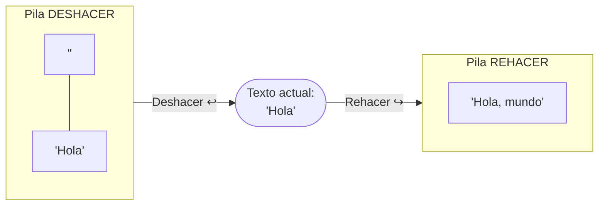

# 🥞 4. Pilas (`Stack<T>`)

← [Listas](03-Listas) · [🏠 Inicio](Home) · Siguiente: [🚶 Colas →](05-Colas)

> **Objetivo:** entender el principio **LIFO**, implementarlo y reconocer los problemas donde una pila es la herramienta natural.
>
> 💻 **Código de este tema:** [`DemoPilas.cs`](https://github.com/chaotzu/colecciones-csharp/blob/main/Ejemplos/03_Pilas/DemoPilas.cs) → `dotnet run -- 3`

---

## 4.1 Definición (ADT)

Una **pila** es un tipo abstracto de datos donde las inserciones y eliminaciones ocurren **en un solo extremo**, llamado **tope**. El elemento que se elimina es siempre el **último que se insertó**: política **LIFO** (*Last In, First Out*) (Cormen et al., 2022, cap. 10; Sedgewick & Wayne, 2011, §1.3).

La imagen mental es una pila de platos: solo tomas o dejas platos por arriba.

```
        push(40)         pop() → 40
           │                 ▲
           ▼                 │
        ┌──────┐   ← tope
        │  40  │
        ├──────┤
        │  30  │
        ├──────┤
        │  20  │
        ├──────┤
        │  10  │   ← fondo
        └──────┘
```

### Operaciones del ADT

| Operación | Descripción | En `Stack<T>` | Costo |
|-----------|-------------|---------------|:-----:|
| *push* | Inserta en el tope | `Push(x)` | O(1) amortizado |
| *pop* | Quita y devuelve el tope | `Pop()` / `TryPop(out x)` | O(1) |
| *peek / top* | Consulta el tope sin quitarlo | `Peek()` / `TryPeek(out x)` | O(1) |
| *isEmpty* | ¿Está vacía? | `Count == 0` | O(1) |
| — | ¿Contiene el valor? | `Contains(x)` | O(n) |

🔬 `Stack<T>` se implementa sobre un **arreglo dinámico** (igual que `List<T>`): `Push` agrega al final y, cuando se llena, duplica la capacidad; de ahí el *amortizado*.

## 4.2 Uso básico

```csharp
var pila = new Stack<string>();
pila.Push("primero");
pila.Push("segundo");
pila.Push("tercero");

pila.Peek();                       // "tercero"  (sigue ahí)
pila.Pop();                        // "tercero"  (ya salió)
pila.Count;                        // 2

while (pila.TryPop(out string? x)) // patrón seguro para vaciar
    Console.WriteLine(x);
```

Salida real del ejemplo:

```
Orden de enumeración (tope -> fondo): [tercero, segundo, primero]
Pop -> tercero
Pop -> segundo
Pop -> primero
Pop en pila vacía lanza InvalidOperationException
```

### ⚠️ Trampas frecuentes

| Trampa | Explicación |
|--------|-------------|
| `Pop()`/`Peek()` en pila vacía | Lanza `InvalidOperationException`. Usa `TryPop`/`TryPeek` o verifica `Count`. |
| El orden de `foreach` | Recorre del **tope al fondo**, es decir, en orden de salida. |
| `new Stack<int>(new[]{1,2,3})` | Hace `Push` de 1, luego 2, luego 3: el tope es **3**. El orden parece "invertido" pero es coherente. |
| Buscar un elemento | `Contains` es O(n). Si lo necesitas mucho, quizá la pila no es la estructura adecuada. |
| No hay indexador | Es intencional: acceder a posiciones intermedias rompería el contrato LIFO. |

## 4.3 Aplicaciones clásicas

### 🔄 Aplicación 1 — Invertir una cadena
Al meter cada carácter y sacarlos, salen en orden inverso.

```csharp
var pila = new Stack<char>("estructuras");   // el último carácter queda en el tope
string invertido = string.Concat(pila);      // "sarutcurtse"
```

### 🧩 Aplicación 2 — Delimitadores balanceados
Compiladores y editores verifican que `() [] {}` estén bien emparejados. La idea: apilar cada apertura; ante un cierre, la apertura **más reciente** debe coincidir.

```csharp
public static bool EstaBalanceada(string texto)
{
    var pila = new Stack<char>();
    foreach (char c in texto)
    {
        switch (c)
        {
            case '(' or '[' or '{':
                pila.Push(c);
                break;
            case ')' or ']' or '}':
                if (!pila.TryPop(out char apertura) || !Coinciden(apertura, c))
                    return false;
                break;
        }
    }
    return pila.Count == 0;       // ¿sobraron aperturas?
}
```

| Entrada | Resultado | Motivo |
|---------|:---------:|--------|
| `(a + b) * [c - {d / e}]` | ✅ | Todo cierra en orden |
| `((a + b)` | ❌ | Sobra una apertura |
| `{[}]` | ❌ | El cierre `}` encuentra `[` en el tope |

### ↩️ Aplicación 3 — Deshacer / Rehacer (*undo / redo*)
Se usan **dos pilas**: cada acción apila el estado anterior en la de *deshacer*; al deshacer, el estado actual pasa a la de *rehacer*. Una acción nueva **vacía** la pila de rehacer. La clase `EditorDeTexto` del [código de ejemplo](https://github.com/chaotzu/colecciones-csharp/blob/main/Ejemplos/03_Pilas/DemoPilas.cs) lo implementa completo.



### 🧮 Aplicación 4 — Notación postfija (RPN)
En `5 1 2 + 4 * + 3 -` no hacen falta paréntesis ni precedencia. Algoritmo: si es número, `Push`; si es operador, `Pop` dos operandos, calcula y `Push` el resultado.

```
Tokens:  5  1  2  +  4  *  +  3  -
Pila:   [5][5,1][5,1,2][5,3][5,3,4][5,12][17][17,3][14]     → resultado 14
```

### 🧱 Otras aplicaciones (para investigar)
- **Pila de llamadas** (*call stack*): cada llamada a un método apila un *marco*; al retornar se desapila. La **recursión infinita** agota esa pila y produce `StackOverflowException`.
- **Recorrido en profundidad (DFS)** en grafos y árboles.
- **Navegación "atrás"** en un navegador web.
- **Evaluación y conversión de expresiones** (algoritmo *shunting-yard*, de Dijkstra).

## 4.4 Complejidad resumida

| Operación | Costo |
|-----------|:-----:|
| `Push` | O(1) amortizado |
| `Pop`, `Peek`, `Count` | O(1) |
| `Contains`, `ToArray` | O(n) |
| Espacio | O(n) |

## 4.5 ¿Cuándo usar una pila?

✅ Cuando el problema tiene **estructura anidada** o necesitas **revertir el orden** o **deshacer** pasos: lo más reciente es lo primero que se atiende.
❌ Cuando necesitas acceder a elementos arbitrarios (→ `List<T>`) o atender por orden de llegada (→ [`Queue<T>`](05-Colas)).

## 🧠 Preguntas para pensar

1. Si empujas `A, B, C` y luego haces `Pop` dos veces, ¿qué queda y qué devolvió cada `Pop`?
2. ¿Cómo implementarías una pila con una `List<T>`? ¿Qué extremo de la lista usarías como tope y por qué?
3. ¿Por qué el algoritmo de balanceo falla (devuelve `false`) con `")("` aunque tenga igual cantidad de aperturas y cierres?
4. ¿Por qué la recursión y las pilas están tan relacionadas?

📝 Practica en [Ejercicios](08-Ejercicios#-pilas).

---
← [Listas](03-Listas) · [🏠 Inicio](Home) · Siguiente: [🚶 Colas →](05-Colas) · [📚 Referencias](Referencias)
