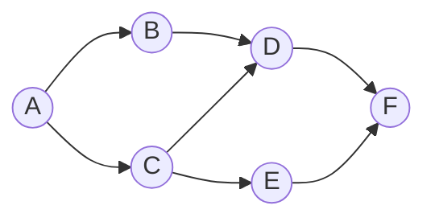

# 🚶 5. Colas (`Queue<T>`)

← [Pilas](04-Pilas) · [🏠 Inicio](Home) · Siguiente: [🗝️ Diccionarios →](06-Diccionarios)

> **Objetivo:** comprender el principio **FIFO**, su implementación como **buffer circular** y la variante con **prioridad**.
>
> 💻 **Código de este tema:** [`DemoColas.cs`](https://github.com/chaotzu/colecciones-csharp/blob/main/Ejemplos/04_Colas/DemoColas.cs) → `dotnet run -- 4`

---

## 5.1 Definición (ADT)

Una **cola** es un tipo abstracto de datos en el que se **inserta por un extremo** (el *final*) y se **elimina por el otro** (el *frente*). El primer elemento en entrar es el primero en salir: política **FIFO** (*First In, First Out*) (Cormen et al., 2022, cap. 10; Sedgewick & Wayne, 2011, §1.3).

```
   Enqueue (entra)                                   Dequeue (sale)
        │                                                 ▲
        ▼                                                 │
      ┌──────┬──────┬──────┬──────┬──────┐
 final│  E   │  D   │  C   │  B   │  A   │frente
      └──────┴──────┴──────┴──────┴──────┘
                                      Peek → A
```

### Operaciones

| Operación | Descripción | En `Queue<T>` | Costo |
|-----------|-------------|---------------|:-----:|
| *enqueue* | Agrega al final | `Enqueue(x)` | O(1) amortizado |
| *dequeue* | Quita y devuelve el frente | `Dequeue()` / `TryDequeue(out x)` | O(1) |
| *peek* | Consulta el frente | `Peek()` / `TryPeek(out x)` | O(1) |
| *isEmpty* | ¿Vacía? | `Count == 0` | O(1) |
| — | ¿Contiene? | `Contains(x)` | O(n) |

## 5.2 🔬 Implementación: el buffer circular

Ingenuamente, una cola sobre un arreglo obligaría a **desplazar** todos los elementos en cada `Dequeue` (O(n)), igual que `List.RemoveAt(0)`. La solución clásica es un **arreglo circular** con dos índices (Cormen et al., 2022, cap. 10):

- `head`: posición del frente.
- `tail`: posición donde se insertará el siguiente.

Al llegar al final del arreglo, los índices **dan la vuelta** (módulo la capacidad), reutilizando los espacios liberados al inicio. Así `Enqueue` y `Dequeue` solo mueven un índice: **O(1)**.

```
Capacidad = 6          head=2                tail=5
                         ▼                     ▼
índices:   0     1     2     3     4     5
         ┌─────┬─────┬─────┬─────┬─────┬─────┐
         │  ·  │  ·  │  C  │  D  │  E  │  ·  │      Dequeue → head pasa a 3
         └─────┴─────┴─────┴─────┴─────┴─────┘      Enqueue → tail pasa a 0 (da la vuelta)
```

Cuando el arreglo se llena, `Queue<T>` reserva uno mayor y copia los elementos en orden: por eso `Enqueue` es O(1) **amortizado**, igual que `Add` en una lista.

⚠️ **Comparación clave:** sacar del frente de una `List<T>` es O(n); de una `Queue<T>`, O(1). Con 30,000 elementos, el ejemplo del repositorio mide la diferencia: la lista tarda cientos de milisegundos y la cola prácticamente cero ([`DemoRendimiento.cs`](https://github.com/chaotzu/colecciones-csharp/blob/main/Ejemplos/06_Comparativa/DemoRendimiento.cs)).

## 5.3 Uso básico

```csharp
var cola = new Queue<string>();
cola.Enqueue("Ana");
cola.Enqueue("Luis");
cola.Enqueue("Marta");

cola.Peek();                         // "Ana"  (no se quita)
cola.Dequeue();                      // "Ana"  (sale primero)

while (cola.TryDequeue(out string? atendido))
    Console.WriteLine(atendido);     // Luis, Marta
```

| Trampa | Explicación |
|--------|-------------|
| `Dequeue()`/`Peek()` en cola vacía | `InvalidOperationException`. Usa `TryDequeue`/`TryPeek`. |
| `foreach` | Recorre del **frente al final** (orden de salida) y **no** extrae elementos. |
| Sin indexador | Igual que en la pila, es parte del contrato del ADT. |
| Hilos | `Queue<T>` no es segura para concurrencia; para productor/consumidor usa `ConcurrentQueue<T>` o `System.Threading.Channels`. |

## 5.4 Aplicaciones clásicas

### 🏦 Aplicación 1 — Turnos de atención
Lo más natural: el primero que llega es el primero atendido.

```csharp
var turnos = new Queue<(int Numero, string Cliente)>();
turnos.Enqueue((1, "Sofía"));
turnos.Enqueue((2, "Raúl"));

while (turnos.Count > 0)
{
    var (numero, cliente) = turnos.Dequeue();
    Console.WriteLine($"Turno #{numero}: pase a ventanilla, {cliente}");
}
```

### 🖥️ Aplicación 2 — Planificación *Round Robin*
Los sistemas operativos reparten el procesador por turnos: cada proceso corre un *quantum* de tiempo y, si no terminó, **vuelve al final de la cola** (Silberschatz et al., 2018). Salida real del ejemplo (quantum = 3):

```
t= 3: P1 corrió 3 y vuelve al final (restan 2)
t= 5: P2 TERMINÓ
t= 8: P3 corrió 3 y vuelve al final (restan 4)
t=10: P1 TERMINÓ
t=13: P3 corrió 3 y vuelve al final (restan 1)
t=14: P3 TERMINÓ
```

### 🌐 Aplicación 3 — Recorrido en anchura (BFS)
Explora un grafo **por niveles**: primero los vecinos del origen, luego los vecinos de los vecinos… La cola garantiza ese orden (Cormen et al., 2022, cap. 20). Además combina colecciones: el grafo es un `Dictionary<string, List<string>>` y los nodos ya visitados se guardan en un `HashSet<string>`.



```csharp
public static List<string> Bfs(Dictionary<string, List<string>> grafo, string inicio)
{
    var orden = new List<string>();
    var visitados = new HashSet<string> { inicio };
    var frontera = new Queue<string>();
    frontera.Enqueue(inicio);

    while (frontera.TryDequeue(out string? nodo))
    {
        orden.Add(nodo);
        foreach (string vecino in grafo[nodo])
            if (visitados.Add(vecino))       // Add devuelve false si ya estaba
                frontera.Enqueue(vecino);
    }
    return orden;
}
// BFS desde A  →  [A, B, C, D, E, F]
```

> 🔁 **Contraste con las pilas:** cambia `Queue` por `Stack` en ese algoritmo y obtienes un recorrido en **profundidad** (DFS). La estructura de datos determina el comportamiento del algoritmo.

### Otras aplicaciones
Colas de impresión, *buffers* de teclado y de red, sistemas de mensajería, manejo de eventos, simulaciones de filas.

## 5.5 Variante: cola de prioridad (`PriorityQueue<TElement, TPriority>`)

En una cola de prioridad **no sale el primero en llegar, sino el de mayor prioridad**. Disponible desde .NET 6.

```csharp
var urgencias = new PriorityQueue<string, int>();   // elemento, prioridad
urgencias.Enqueue("Dolor de cabeza leve", 5);
urgencias.Enqueue("Paro cardiaco", 1);
urgencias.Enqueue("Fractura", 3);

while (urgencias.TryDequeue(out string? paciente, out int prioridad))
    Console.WriteLine($"Prioridad {prioridad}: {paciente}");
// 1: Paro cardiaco · 3: Fractura · 5: Dolor de cabeza leve
```

| Aspecto | Detalle |
|---------|---------|
| Orden | **Menor valor de prioridad sale primero** (*min-heap*). Para invertirlo, pasa un comparador. |
| Implementación | Un **montículo** (*heap*) almacenado en un arreglo (Cormen et al., 2022, cap. 6). |
| `Enqueue` / `Dequeue` | O(log n) |
| `Peek` | O(1) |
| Estabilidad | **No** estable: elementos con igual prioridad pueden salir en cualquier orden. |
| Usos | Triaje, planificación con prioridades, algoritmo de Dijkstra, simulaciones por eventos |

## 5.6 ¿Y una cola de doble extremo (*deque*)?

Un *deque* permite insertar y quitar por **ambos** extremos. .NET no incluye una clase `Deque<T>` en su biblioteca base; se puede emular con `LinkedList<T>` (`AddFirst`, `AddLast`, `RemoveFirst`, `RemoveLast`) o implementar sobre un buffer circular (buen ejercicio de clase).

## 5.7 Complejidad resumida

| Operación | `Queue<T>` | `PriorityQueue` |
|-----------|:----------:|:---------------:|
| Insertar | O(1) amortizado | O(log n) |
| Extraer | O(1) | O(log n) |
| Consultar el siguiente | O(1) | O(1) |
| `Contains` | O(n) | — (no ofrece) |

## 5.8 ¿Cuándo usar una cola?

✅ Cuando el **orden de llegada** determina el orden de atención, o para **explorar por niveles**.
✅ `PriorityQueue` cuando el orden lo decide una **prioridad**, no la llegada.
❌ Si necesitas acceso aleatorio o búsquedas por valor, otra estructura será mejor.

## 🧠 Preguntas para pensar

1. ¿Por qué un arreglo **circular** evita el costo O(n) de desplazar elementos?
2. En Round Robin, ¿qué pasaría con el tiempo de respuesta si el *quantum* fuera enorme? ¿Y si fuera diminuto?
3. Si cambias la cola de BFS por una pila, ¿qué recorrido obtienes? ¿Cambia el *conjunto* de nodos visitados?
4. ¿Cómo usarías `PriorityQueue` para que salga primero el de **mayor** número?

📝 Practica en [Ejercicios](08-Ejercicios#-colas).

---
← [Pilas](04-Pilas) · [🏠 Inicio](Home) · Siguiente: [🗝️ Diccionarios →](06-Diccionarios) · [📚 Referencias](Referencias)
