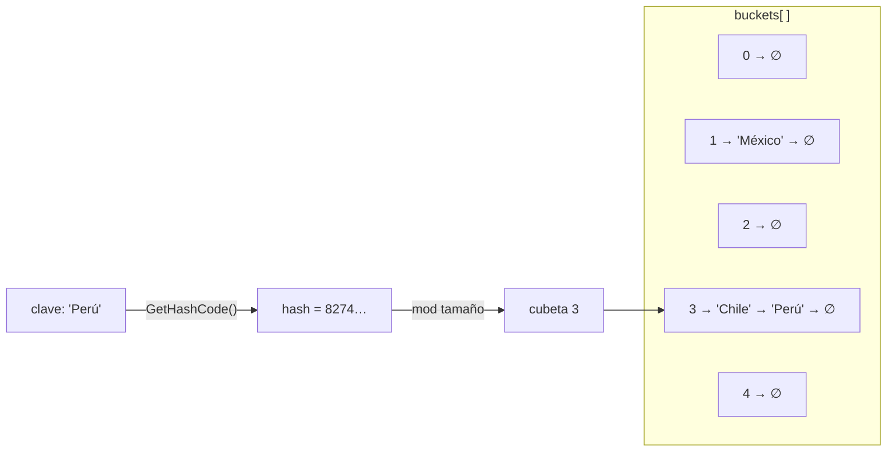

# 🗝️ 6. Diccionarios (`Dictionary<TKey, TValue>`)

← [Colas](05-Colas) · [🏠 Inicio](Home) · Siguiente: [⚖️ Comparativa →](07-Comparativa-y-Complejidad)

> **Objetivo:** comprender la tabla hash, por qué logra búsquedas casi instantáneas y qué se le exige a las claves.
>
> 💻 **Código de este tema:** [`DemoDiccionarios.cs`](https://github.com/chaotzu/colecciones-csharp/blob/main/Ejemplos/05_Diccionarios/DemoDiccionarios.cs) → `dotnet run -- 5`

---

## 6.1 Definición (ADT)

Un **diccionario** (también *arreglo asociativo*, *mapa* o *tabla de símbolos*) es un tipo abstracto de datos que almacena **pares clave → valor** con **claves únicas** y permite insertar, buscar y eliminar por clave (Cormen et al., 2022, cap. 11; Sedgewick & Wayne, 2011, cap. 3).

`Dictionary<TKey, TValue>` lo implementa con una **tabla hash** (Microsoft, s. f.-d).

```csharp
var capitales = new Dictionary<string, string>
{
    ["México"]    = "Ciudad de México",
    ["Argentina"] = "Buenos Aires",
};
Console.WriteLine(capitales["México"]);     // Ciudad de México
```

## 6.2 🔬 ¿Cómo logra O(1)? — La tabla hash

Una lista tendría que comparar clave por clave (O(n)). La tabla hash **calcula directamente dónde está** la clave:

1. Se calcula `hash = clave.GetHashCode()`, un entero que "resume" la clave.
2. Se reduce a un **índice de cubeta** (*bucket*): `índice = hash mod tamaño`.
3. Se mira solo esa cubeta.



### Colisiones

Como hay muchas más claves posibles que cubetas, **dos claves distintas pueden caer en la misma cubeta**: una **colisión**. Las dos estrategias clásicas son (Cormen et al., 2022, cap. 11):

| Estrategia | Idea |
|------------|------|
| **Encadenamiento** (*chaining*) | Cada cubeta guarda una pequeña cadena con todas las claves que colisionan. |
| **Direccionamiento abierto** | Si la posición está ocupada, se prueba otra según una secuencia. |

.NET usa **encadenamiento**, implementado con dos arreglos: `buckets[]` (apunta al primer elemento de cada cadena) y `entries[]` (cada entrada guarda clave, valor, hash y el índice de la siguiente en la cadena). Es una variante eficiente en memoria contigua (código fuente: [dotnet/runtime](https://github.com/dotnet/runtime), archivo `Dictionary.cs`).

### Factor de carga y redimensión

Si hay muchas entradas por cubeta, las cadenas se alargan y se pierde la velocidad. Cuando la tabla se llena, `Dictionary` reserva una **más grande** (de tamaño primo) y **recoloca todas las entradas** (*rehash*), lo que cuesta O(n) pero ocurre pocas veces: de nuevo, un costo **amortizado**.

| | Mejor / promedio | Peor caso |
|--|:----------------:|:---------:|
| Buscar, insertar, eliminar | **O(1)** | O(n) (todas las claves en la misma cubeta) |

El O(1) vale **en promedio**, bajo el supuesto de que la función hash reparte las claves de manera uniforme (Cormen et al., 2022, cap. 11).

## 6.3 Operaciones principales

| Operación | Código | Observaciones |
|-----------|--------|---------------|
| Agregar | `d.Add(k, v)` | **Lanza** `ArgumentException` si la clave ya existe |
| Agregar o actualizar | `d[k] = v` | No falla si existe |
| Agregar solo si no existe | `d.TryAdd(k, v)` | Devuelve `bool` |
| Leer (puede fallar) | `d[k]` | **Lanza** `KeyNotFoundException` si no existe |
| Leer seguro | `d.TryGetValue(k, out v)` | Una sola búsqueda; ✅ preferido |
| Leer con valor por defecto | `d.GetValueOrDefault(k, def)` | Sin excepciones |
| ¿Existe la clave? | `d.ContainsKey(k)` | O(1) |
| ¿Existe el valor? | `d.ContainsValue(v)` | **O(n)** |
| Eliminar | `d.Remove(k)` | O(1) |
| Recorrer | `foreach (var par in d)` | `par.Key`, `par.Value` |
| Solo claves / valores | `d.Keys`, `d.Values` | Vistas, no copias |

```csharp
// ✅ Patrón recomendado: una sola búsqueda hash
if (precios.TryGetValue("leche", out decimal precio))
    Console.WriteLine($"leche cuesta {precio:F2} MXN");

// ⚠️ Patrón ineficiente: dos búsquedas (ContainsKey + indexador)
if (precios.ContainsKey("leche"))
    Console.WriteLine(precios["leche"]);
```

## 6.4 Patrones imprescindibles

### 📊 Contar frecuencias

```csharp
string texto = "la pila y la cola son colecciones la lista tambien";
var frecuencia = new Dictionary<string, int>();

foreach (string palabra in texto.Split(' '))
    frecuencia[palabra] = frecuencia.GetValueOrDefault(palabra) + 1;
```

Resultado: `la → 3`, y las demás palabras `→ 1`.

### 🗂️ Agrupar elementos por clave (`Dictionary<K, List<V>>`)

```csharp
var porGrupo = new Dictionary<string, List<Estudiante>>();
foreach (var e in estudiantes)
{
    if (!porGrupo.TryGetValue(e.Grupo, out var lista))
    {
        lista = new List<Estudiante>();
        porGrupo[e.Grupo] = lista;       // se crea la lista la primera vez
    }
    lista.Add(e);
}
// Grupo A: Carlos, Diego, Elena   ·   Grupo B: Beatriz, Ana
```

> 💡 LINQ lo resume en una línea con `GroupBy`, pero entender el patrón manual te enseña qué ocurre por debajo.

## 6.5 Requisitos de las claves: `Equals` y `GetHashCode`

Para que el diccionario funcione, la clave debe cumplir un **contrato** (Microsoft, s. f.-d):

1. Si `a.Equals(b)` es `true`, entonces `a.GetHashCode() == b.GetHashCode()`.
2. El hash de una clave **no debe cambiar** mientras esté en el diccionario → usa claves **inmutables**.

Si no se cumple, el diccionario "pierde" las claves: las busca en la cubeta equivocada. Salida real del ejemplo:

```
Clase sin Equals/GetHashCode: ContainsKey(new(1,2)) = False   ← compara por referencia
record struct:                ContainsKey(new(1,2)) = True    ← igualdad por valor
```

```csharp
class PuntoClase(int x, int y) { public int X { get; } = x; public int Y { get; } = y; }
readonly record struct PuntoValor(int X, int Y);   // Equals y GetHashCode generados
```

✅ **Recomendación:** para claves compuestas usa `record`, `record struct` o tuplas `(int, int)`; el compilador genera la igualdad por valor.

### Comparadores personalizados

```csharp
var d = new Dictionary<string, int>(StringComparer.OrdinalIgnoreCase);
d["Admin"] = 1;
d.ContainsKey("ADMIN");   // true
```

Por defecto la comparación de cadenas distingue mayúsculas y minúsculas.

## 6.6 ⚠️ El orden **no** está garantizado

Un `Dictionary` no promete ningún orden al recorrerlo. En la práctica suele parecer el de inserción, pero **eliminar y volver a insertar** lo altera, porque la nueva entrada reutiliza el hueco liberado:

```
Inicial            : [a, b, c]
Tras Remove("b") + agregar "d": [a, d, c]
```

Si necesitas orden, usa `SortedDictionary` o ordena al consumir (`OrderBy`).

## 6.7 La familia de diccionarios y conjuntos

| Tipo | Implementación | Búsqueda | Orden | Cuándo usarlo |
|------|----------------|:--------:|:-----:|---------------|
| `Dictionary<K,V>` | Tabla hash | O(1) prom. | No garantizado | **Opción por defecto** |
| `SortedDictionary<K,V>` | Árbol rojo-negro | O(log n) | Por clave | Necesitas recorrido ordenado con inserciones frecuentes |
| `SortedList<K,V>` | Dos arreglos ordenados | O(log n) | Por clave | Pocas inserciones, mucha lectura, poca memoria |
| `HashSet<T>` | Tabla hash (solo claves) | O(1) prom. | No garantizado | Pertenencia y conjuntos (∪, ∩, \\) |
| `ConcurrentDictionary<K,V>` | Hash con bloqueos finos | O(1) prom. | No | Acceso desde varios hilos |
| `FrozenDictionary<K,V>` | Hash optimizado e inmutable (.NET 8+) | O(1) | No | Se llena una vez y se consulta muchas |
| `Hashtable` | Hash **no genérico** | O(1) prom. | No | ⚠️ Heredada; evitar |

### `HashSet<T>`: el "diccionario sin valores"

```csharp
var a = new HashSet<int> { 1, 2, 3, 4 };
var b = new HashSet<int> { 3, 4, 5, 6 };

a.Add(3);                   // false: duplicado ignorado
a.UnionWith(b);             // A ∪ B
a.IntersectWith(b);         // A ∩ B
a.ExceptWith(b);            // A \ B
```

Perfecto para eliminar duplicados o comprobar "¿ya lo vi?" en O(1), como en el `visitados` del BFS ([Colas §5.4](05-Colas#54-aplicaciones-clásicas)).

## 6.8 Trampas frecuentes

| Trampa | Solución |
|--------|----------|
| `KeyNotFoundException` | Usar `TryGetValue` o `GetValueOrDefault` |
| `Add` con clave repetida | Usar el indexador `d[k] = v` o `TryAdd` |
| Clave `null` | `Dictionary` **no** admite claves `null` (`ArgumentNullException`) |
| Claves mutables | Usar tipos inmutables (`string`, `record`, tuplas) |
| Modificar durante `foreach` | Agregar claves durante el recorrido invalida el enumerador. Para eliminar, recoge primero las claves en una lista y luego bórralas. |
| Suponer orden | Nunca depender del orden de enumeración |

## 6.9 ¿Cuándo usar un diccionario?

✅ Siempre que necesites **encontrar por una clave**: catálogos, cachés, índices, conteos, relaciones id → objeto, grafos (id → vecinos).
❌ Cuando solo recorres en orden o accedes por posición → `List<T>`; cuando necesitas el orden de las claves → `SortedDictionary`.

## 🧠 Preguntas para pensar

1. ¿Por qué una buena función hash es la clave del rendimiento? ¿Qué pasaría si `GetHashCode()` devolviera siempre `1`?
2. ¿Por qué `ContainsValue` es O(n) aunque `ContainsKey` sea O(1)?
3. ¿Qué problema habría si usaras como clave un objeto `Persona` cuyo `Nombre` cambia después de insertarla?
4. ¿Qué estructura usarías para eliminar duplicados de una lista de un millón de enteros? ¿Cuál es el costo total?

📝 Practica en [Ejercicios](08-Ejercicios#-diccionarios).

---
← [Colas](05-Colas) · [🏠 Inicio](Home) · Siguiente: [⚖️ Comparativa →](07-Comparativa-y-Complejidad) · [📚 Referencias](Referencias)
