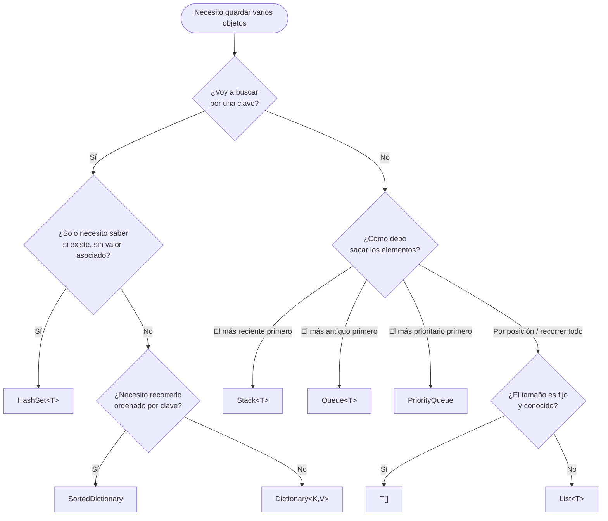

# ⚖️ 7. Comparativa y complejidad

← [Diccionarios](06-Diccionarios) · [🏠 Inicio](Home) · Siguiente: [📝 Ejercicios →](08-Ejercicios)

> **Objetivo:** integrar todo lo visto y desarrollar el criterio para **elegir y justificar** una colección.
>
> 💻 **Código de este tema:** [`DemoRendimiento.cs`](https://github.com/chaotzu/colecciones-csharp/blob/main/Ejemplos/06_Comparativa/DemoRendimiento.cs) → `dotnet run -c Release -- 6`

---

## 7.1 Tabla maestra de complejidad

| Operación | `T[]` | `List<T>` | `Stack<T>` | `Queue<T>` | `Dictionary<K,V>` |
|-----------|:-----:|:---------:|:----------:|:----------:|:-----------------:|
| Acceso por índice | **O(1)** | **O(1)** | — | — | — |
| Acceso por clave | — | — | — | — | **O(1)\*** |
| Agregar al final / *push* / *enqueue* | — (tamaño fijo) | O(1)† | O(1)† | O(1)† | — |
| Agregar con clave | — | — | — | — | O(1)\*† |
| Insertar en el medio / al inicio | O(n) | O(n) | — | — | — |
| Quitar el último / tope | — | O(1) | O(1) | — | — |
| Quitar el primero / frente | — | **O(n)** | — | O(1) | — |
| Quitar por valor o clave | O(n) | O(n) | — | — | O(1)\* |
| Buscar un valor | O(n) | O(n) | O(n) | O(n) | O(n) (`ContainsValue`) |
| Buscar si está **ordenado** | O(log n) | O(log n) | — | — | — |
| Recorrer | O(n) | O(n) | O(n) | O(n) | O(n) |
| Espacio | O(n) | O(n) | O(n) | O(n) | O(n) |

<sub>† amortizado (puede haber una redimensión ocasional de costo O(n)) · \* en promedio; peor caso O(n) · "—" = la estructura no ofrece esa operación por diseño.</sub>

> 💡 Que una operación **no exista** también es información: `Stack<T>` y `Queue<T>` no ofrecen indexador porque restringir el acceso es precisamente lo que define su ADT.

## 7.2 Comparación cualitativa

| Criterio | `T[]` | `List<T>` | `Stack<T>` | `Queue<T>` | `Dictionary<K,V>` |
|----------|:-----:|:---------:|:----------:|:----------:|:-----------------:|
| ¿Tamaño variable? | ❌ | ✅ | ✅ | ✅ | ✅ |
| ¿Permite duplicados? | ✅ | ✅ | ✅ | ✅ | Claves ❌ · Valores ✅ |
| ¿Mantiene orden de inserción? | ✅ | ✅ | LIFO | FIFO | ⚠️ no garantizado |
| ¿Acceso aleatorio? | ✅ | ✅ | ❌ | ❌ | Por clave |
| Uso de memoria | Mínimo | Bajo (+ capacidad sobrante) | Bajo | Bajo | Mayor (cubetas + entradas) |
| Principal fortaleza | Velocidad y simplicidad | Versatilidad | Deshacer / anidamiento | Orden de llegada | Búsqueda por clave |

## 7.3 Árbol de decisión



## 7.4 Escenarios para razonar

| Escenario | Elección | Justificación |
|-----------|----------|---------------|
| Guardar los 12 nombres de los meses | `string[]` | Tamaño fijo y conocido; sin sobrecarga |
| Lista de compras que el usuario edita | `List<string>` | Crece, decrece y se recorre en orden |
| Botón "Deshacer" de un editor | `Stack<T>` | Lo último hecho es lo primero a deshacer |
| Fila de impresión | `Queue<T>` | Se imprime en orden de llegada |
| Buscar el precio de un producto por su código | `Dictionary<string, decimal>` | Búsqueda O(1) por clave |
| Detectar si un correo ya fue procesado | `HashSet<string>` | Pertenencia O(1) sin valores asociados |
| Atender urgencias médicas | `PriorityQueue<Paciente, int>` | Sale el más grave, no el más antiguo |
| Verificar paréntesis balanceados | `Stack<char>` | Estructura anidada → LIFO |
| Recorrer un grafo por niveles | `Queue<T>` + `HashSet<T>` | BFS necesita FIFO y marcar visitados |

## 7.5 Más allá del Big-O: localidad de memoria

El análisis asintótico ignora un factor decisivo en hardware real: **la caché de la CPU**. Los arreglos (y por tanto `List<T>`, `Stack<T>`, `Queue<T>`) guardan los datos **contiguos**, de modo que recorrerlos aprovecha la caché. Las estructuras con nodos dispersos (`LinkedList<T>`) provocan más fallos de caché. Por eso:

> A tamaños pequeños o medianos, una búsqueda lineal en un arreglo puede superar a una tabla hash, y `List<T>` suele superar a `LinkedList<T>` aunque el análisis teórico indique lo contrario.

**Conclusión metodológica:** el Big-O sirve para descartar opciones malas a gran escala; para decidir entre opciones razonables, **mide con datos reales** (Sedgewick & Wayne, 2011, §1.4).

## 7.6 Experimento del repositorio

`DemoRendimiento.cs` compara dos situaciones. Tus números variarán según tu equipo; lo importante es el **orden de magnitud**.

| Experimento | Estructuras | Qué muestra |
|-------------|-------------|-------------|
| Buscar 2,000 valores ausentes en 50,000 elementos | `List.Contains` vs `HashSet.Contains` vs `Dictionary.ContainsKey` | O(n) frente a O(1) |
| Quitar del frente 30,000 elementos | `List.RemoveAt(0)` vs `Queue.Dequeue` | O(n²) total frente a O(n) total |

```bash
dotnet run -c Release -- 6
```

⚠️ **Limitaciones honestas:** `Stopwatch` con una sola corrida es una medición **didáctica**, no científica. Para resultados confiables usa [BenchmarkDotNet](https://benchmarkdotnet.org/), que controla calentamiento, repeticiones y estadística.

## 🧠 Preguntas para pensar

1. En la tabla maestra, ¿por qué "quitar el primero" es O(n) en `List<T>` pero O(1) en `Queue<T>`? Relaciónalo con el buffer circular.
2. ¿Por qué el experimento de búsqueda usa valores **ausentes**? ¿Qué pasaría si buscáramos siempre el primer elemento?
3. Propón un caso donde `List<T>` sea mejor opción que `Dictionary` aunque se "busque" por valor.

---
← [Diccionarios](06-Diccionarios) · [🏠 Inicio](Home) · Siguiente: [📝 Ejercicios →](08-Ejercicios) · [📚 Referencias](Referencias)
