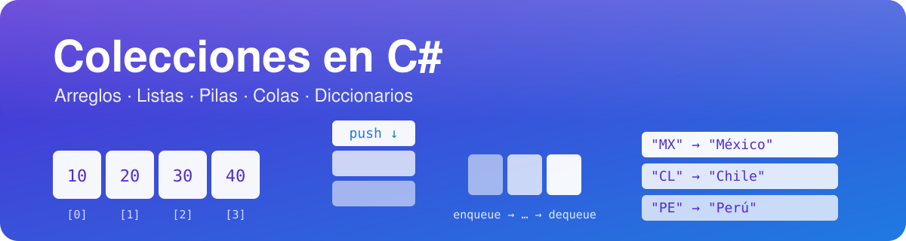
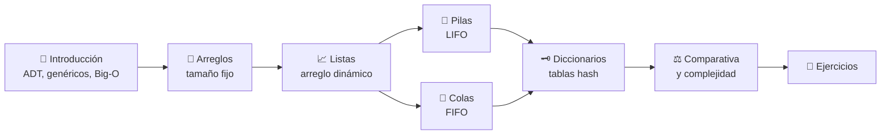

[](https://learn.microsoft.com/en-us/dotnet/csharp/)
[](https://dotnet.microsoft.com/)
[](https://github.com/chaotzu/colecciones-csharp/tree/main/Ejemplos)
[](#-cómo-citar-estos-apuntes)

# 📚 Colecciones de objetos en C#

> Apuntes de clase sobre las estructuras de datos más usadas en .NET: **arreglos, listas, pilas, colas y diccionarios**. Cada tema combina fundamento teórico, análisis de complejidad, código ejecutable y referencias bibliográficas.

---

## 🎯 ¿Qué vas a aprender?

Al terminar estos apuntes podrás:

1. **Distinguir** entre un *tipo abstracto de datos* (qué hace) y su *implementación* (cómo lo hace).
2. **Elegir** la colección adecuada para un problema justificando tu decisión con análisis de complejidad (notación O).
3. **Explicar** cómo funcionan por dentro `T[]`, `List<T>`, `Stack<T>`, `Queue<T>` y `Dictionary<TKey,TValue>`.
4. **Implementar** aplicaciones clásicas: balanceo de paréntesis, deshacer/rehacer, planificación de procesos, recorrido de grafos y conteo de frecuencias.
5. **Evitar** los errores típicos: `IndexOutOfRangeException`, modificar una colección dentro de `foreach`, `KeyNotFoundException`, claves mal comparadas…

## 🗺️ Ruta de aprendizaje



## 📖 Índice

| # | Tema | Idea clave | Código de ejemplo |
|:-:|------|------------|-------------------|
| 1 | [🧭 Introducción a las colecciones](01-Introduccion-a-las-Colecciones) | ADT, interfaces, genéricos, `IEnumerable<T>` | — |
| 2 | [🧱 Arreglos](02-Arreglos) | Memoria contigua, tamaño fijo, acceso O(1) | [`DemoArreglos.cs`](https://github.com/chaotzu/colecciones-csharp/blob/main/Ejemplos/01_Arreglos/DemoArreglos.cs) |
| 3 | [📈 Listas](03-Listas) | Arreglo dinámico, crecimiento amortizado | [`DemoListas.cs`](https://github.com/chaotzu/colecciones-csharp/blob/main/Ejemplos/02_Listas/DemoListas.cs) |
| 4 | [🥞 Pilas](04-Pilas) | LIFO: *push*, *pop*, *peek* | [`DemoPilas.cs`](https://github.com/chaotzu/colecciones-csharp/blob/main/Ejemplos/03_Pilas/DemoPilas.cs) |
| 5 | [🚶 Colas](05-Colas) | FIFO, buffer circular, cola de prioridad | [`DemoColas.cs`](https://github.com/chaotzu/colecciones-csharp/blob/main/Ejemplos/04_Colas/DemoColas.cs) |
| 6 | [🗝️ Diccionarios](06-Diccionarios) | Hash, colisiones, `Equals`/`GetHashCode` | [`DemoDiccionarios.cs`](https://github.com/chaotzu/colecciones-csharp/blob/main/Ejemplos/05_Diccionarios/DemoDiccionarios.cs) |
| 7 | [⚖️ Comparativa y complejidad](07-Comparativa-y-Complejidad) | Tablas Big-O y cómo elegir | [`DemoRendimiento.cs`](https://github.com/chaotzu/colecciones-csharp/blob/main/Ejemplos/06_Comparativa/DemoRendimiento.cs) |
| 8 | [📝 Ejercicios y autoevaluación](08-Ejercicios) | Práctica guiada + preguntas con respuesta | — |
| 9 | [🔤 Glosario](Glosario) | Vocabulario técnico | — |
| 10 | [📚 Referencias](Referencias) | Bibliografía en formato APA 7 | — |

## ▶️ Cómo ejecutar los ejemplos

Necesitas el [SDK de .NET 8](https://dotnet.microsoft.com/download) o superior.

```bash
git clone https://github.com/chaotzu/colecciones-csharp.git
cd colecciones-csharp/Ejemplos

dotnet run                  # menú interactivo
dotnet run -- 3             # ejecuta solo el demo n.º 3 (Pilas)
dotnet run -- todo          # ejecuta todos los demos
dotnet run -c Release -- 6  # comparativa de rendimiento (mejor en Release)
```

> [!TIP]
> Durante la clase, abre el archivo de ejemplo en un lado de la pantalla y la terminal en el otro: cada método imprime lo que ocurre paso a paso. Los bloques de código están separados con comentarios `// #region` para encontrarlos rápido.

## 🧪 Convenciones de estos apuntes

| Símbolo | Significado |
|:-------:|-------------|
| 💡 | Idea importante o intuición |
| ⚠️ | Error común o trampa |
| 🔬 | Profundización: cómo funciona por dentro |
| 🧠 | Pregunta para pensar |
| `(Cormen et al., 2022)` | Cita en formato APA 7; la ficha completa está en [Referencias](Referencias) |

## 🧾 Cómo citar estos apuntes

> Apellido, N. (2026). *Colecciones de objetos en C#: apuntes de clase* [Wiki de GitHub]. GitHub. https://github.com/chaotzu/colecciones-csharp/wiki

## 🤝 Contribuir

¿Encontraste una errata o quieres añadir un ejemplo? Abre un *issue* o un *pull request* en el [repositorio](https://github.com/chaotzu/colecciones-csharp).
